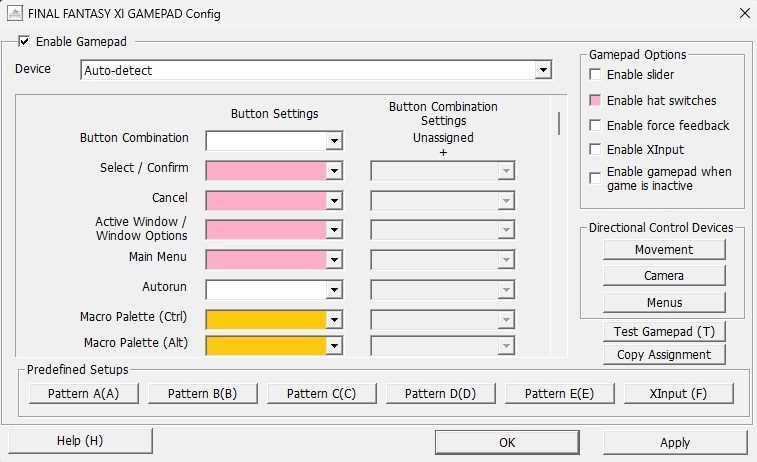
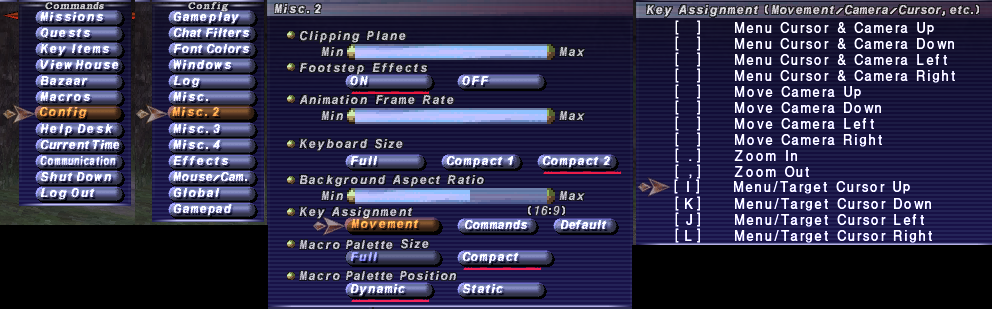

# XIVCrossbar DirectLink — Unbound

**Development branch · October 17, 2026 · keyboard-free controller transport.**

Preserved checkpoint: `snapshot/directlink-unbound-20261016`.
Future work: `development/directlink`. See the [snapshot record](docs/SNAPSHOT-DIRECTLINK-UNBOUND-1.md)
and [branch map](docs/BRANCH-MAP.md) to distinguish the two older Personal lines.
Snapshot 1 preserves the live-tested Personal 9 Test 6. This working branch adds
chooser cancellation repairs, opt-in render diagnostics and R on an unused R1
release, plus the opt-in real-IJKL comparison below; live checks are pending.
The current checkpoint also stages unfamiliar centered text before revealing it.

Runtime: **0.4.0-a.20261018.directlink1-r1menus1**; shared wrapper Controls **9.8-r1-menus**.
Reload Lua AND restart the shared AHK wrapper for these R1 shortcuts.
Author: A. DirectLink development line. Initial live message-transport operation
is confirmed by the user's trace and feedback; broader acceptance remains pending.

## Development roadmap

The [shoulder-bank design](docs/SHOULDER-BANKS.md) records current storage,
the L1/R1/ordered-trigger plan and compatible migration to one editable system.

Current new shortcuts: R1+Square sends `trust menu close`; R1+Triangle sends
`trust menu open` directly through Windower. Use profile x with messages ON;
controller status reports R1 protocol=1 and permission. Both chords consume the
face press and the R1 hold, so no ordinary face action or release-R follows.
Native FFXI menus may remain open; chat, XIVCrossbar editors and trigger bars
exclude these personal commands. Other R1 arrows/Enter/Escape remain available.
Trust's current menu test branch needs the [explicit-Open addendum](https://github.com/rerorriM-Mirrorer/trust/commit/17d0f9cc1e8dd400c70ae8411e4ff805d9868129)
supplied with this checkpoint: update only commands/MenuCommands.lua over the
compatible Test 4 install, reload Trust and check menu status for explicit open.
Open preserves an existing submenu; Close retains Trust's
save/validation policy and closes only Trust menus. Native acceptance is pending.

The [current roadmap and render diagnostics](docs/ROADMAP-DIRECTLINK.md)
separates open repairs, controller ideas, older optional work and completed features.
Chooser Cancel now reaches the configured face button correctly. Controller
status labels the requested/active route separately from its legacy key modifier.

The [folder audit and cleanup plan](docs/FOLDER-STRUCTURE.md) identifies runtime
asset paths and proposed module moves. No runtime files have been relocated.
[Optional templates and presets](examples/README.md) now include the recovered
Cioara and Franklet/Lionstag All Jobs Default bars with their paired catalog.

## Real keyboard IJKL comparison — opt-in

Restart Lua **and** the shared wrapper after updating. Preserve installed data,
settings and personal artwork. This test is for profile `x` (PS5 Extended):

```
//xb messages on
//xb dpad ijkl
//xb inputtest off
//xb realkeys on
//xb controller status
```

Return every control to neutral after switching. Ordinary D-pad Up/Right/Down/
Left sends AHK keyboard I/L/K/J down/up instead of Lua `setkey`. Those owned
directions are withheld from DirectLink, so Lua does not also output the same
press. Triggers, face buttons, existing L1/R1 combinations and other profiles
retain their routes. Chat, XIVCrossbar editors, triggers, other controller
buttons and physical modifiers exclude this ordinary-key route. A consumed hold
stays consumed until release. Native game menus do not disable it; L1's native-
menu hide guard remains unchanged. This is not a general Lua-to-AHK key service.

`//xb realkeys off` restores the existing route after neutral. Bare toggles;
`status` only reports. OFF is the default; an explicit choice is saved per client.
Wrapper status must show Controls=9.7-realkeys and realkeys protocol=1. Output
permission=ahk is permission, not proof a guarded key fired or that Trust consumed
it. Old wrappers continue the established Lua route and produce a restart warning.
Trust must separately recognize **and block** IJKL to prevent game leakage; no
Trust code is changed here. Native AHK/FFXI/Trust acceptance remains pending.

## Quiet text/layout diagnosis

Centered companion labels, crossbar captions and binder headings now share a
bounded measurement cache. An unfamiliar caption stays transparent, including
outline/background, until its width agrees across two later render frames.
Its final position is applied before restoring the current requested opacity.
Known caption/font/style widths can be reused immediately. Font fitting and
scale changes invalidate the appropriate width; dragging only changes position.

`//xb textsettle [on|off|status]` controls this comparison (default ON; bare
toggles). OFF bypasses the settling/cache and restores immediate measurement.
The setting follows character configuration refreshes. If native measurements
never arrive, an eight-frame limit reveals the label at a fixed fallback
position rather than leaving it invisible. Matching widths are a settling
heuristic, not a renderer acknowledgment; native verification is pending.
Test first-use/repeated reveals, long titles, quick page/set switches and fades.
In particular, verify that fully transparent text still receives fresh extents
in Windower. Compare OFF if labels appear late or use the fallback position.
Render trace includes `text-settle` pending/ready/fallback/bypass transitions.

```
//xb rendertrace on
//xb rendertrace mark
//xb rendertrace save
//xb rendertrace off
```

Turn on before reproducing a text hop. Mark after noticing it, then save promptly.
Save leaves capture running; off saves and stops. Bare command/status reports state.
Logs overwrite `data/render-trace-<character>.log` on each save; copy a useful log
before saving another capture. Capture starts OFF on addon load and is not saved
as a setting. Save before unloading; the in-memory history otherwise disappears.

No overlay or per-frame disk writing. The most recent 6,000 changed events are
retained, with call counters, timestamps/frame IDs, captions/revisions, existing
extent results, placement/font/opacity requests, context and object lifetimes.
Repeated identical caption writes remain events; other unchanged calls increment
counters. History duration depends on activity. Trace adds CPU work while on;
native performance needs live comparison. It observes Lua requests/returned
measurements, not final GPU pixels. It does not change text opacity or positioning.
If useful, capture `//xb controller trace on` alongside it for input correlation.

## Message-based controller experiment

**PS5 Extended now defaults to messages. Restart both Lua and the AHK wrapper.**
L2/R2, their combinations and double taps use the existing Lua bar logic.
The twelve ordinary buttons share one ordered stream, so a face-button press
cannot overtake its trigger in a separate keyboard channel. These messages emit
no Apps or F1–F12 keystrokes. Native gameplay outputs still use the existing
Lua translation; personal L1/R1/touch/click/targeting shortcuts keep their paths.

```
//xb messages status
//xb messages off
//xb messages on
//xb controller status
```

Bare `//xb messages` toggles. The setting saves per character. Return buttons to
neutral after a switch; status reports the active wrapper route and sent/ack
counts. Off restores Apps/F-key transport. Other controller profiles retain it.

Complete, sequenced snapshots preserve quick taps and reject duplicates, partial
writes, stale sessions and another client's input. An advancing heartbeat detects
an interrupted writer; held input clears after 350 ms without one. Focus changes,
logout, restart and cutscenes cancel the message session. Overdue unacknowledged
input is cancelled, and route/client changes require neutral before new presses.
Native menu detection still hides both L1 companions while ordinary menu input
remains available. This is a live experiment: source/simulated checks pass, and initial in-game
message delivery is confirmed. Broader responsiveness, lifecycle and low-frame-rate
acceptance still needs testing.

## Input handoff repair and F8 acquisition

The supplied trace catches brief context-file misses that disarm L1 until neutral,
and a filter-enumeration defect that can leak a held button for one poll. Test 4
finishes masking before removing released filter entries. Missing leases get one
immediate retry; a still-unknown observation pauses new downs for at most 100 ms
before an armed gesture is cancelled. No cached permission executes new actions;
valid current context resumes. Real stale/menu/focus/token changes still rearm.

These repair observed failure paths. General stickiness on Frank's desktop is
not yet proven resolved; laptop Franklet is reported much smoother. The native
sender's key delay, polling interval and device thresholds are unchanged.

Target acquisition now defaults to **R3 on, R2 off**. Test 5 adopts that choice
once for existing settings; later explicit choices persist. An unused R1 release
sends R once; any controller chord consumes that hold and prevents the release R.
Shared is disabled for fresh settings; existing explicit Shared preferences remain.

Private testing shortcuts (long forms remain available):

| Command | Effect |
| --- | --- |
| `//xb x [device]` | Select PS5 Extended, optional device |
| `//xb r2` / `//xb r3` | Toggle F8 acquisition on that button |
| `//xb both` | Enable both unless both are on; then disable both |
| `//xb r2 on` / `//xb r3 off` | Set explicitly; also accepts `status` |

Independent targeting controls remain available:

```
//xb controller target
//xb controller target r2 on
//xb controller target r3 on
//xb controller target both on
//xb controller target both off
```

A fresh unmodified R2 emits plain F8 down/up before its ordinary trigger event
(Apps+F12 only in keyboard mode). A fresh unmodified
R3 emits F8 on press and retains R on unused release. Guards skip acquisition in
reported menus/chat/cutscenes or existing capture/combos/held keyboard modifiers.
Same-poll R2+face skips F8 and retains its ordinary combo. R3-first zoom also gets
the initial F8; L3-first zoom does not. Settings save per character; return neutral
after changing them. The existing native send delay separates F8 down/up, with no
additional Sleep. Two extra sends can add roughly 30 ms on the traced system;
output ordering does not confirm the game's target update has completed.

See the [complete controller reference](docs/CONTROLLER-REFERENCE.md) for every
profile, mapping, trigger bank, routing distinction and diagnostic limitation.

Switching sets replaces populated action labels directly, without clearing them
first. Identical labels therefore reuse the native glyph cache. This addresses
one source of transient redraws; live switching/recentering still needs checking.

## Momentary L1 layers

| Input | Behavior |
| --- | --- |
| Hold L1 | Reveal keyboard-shortcut companion; release hides it |
| L1, then add L2 | Reveal the saved action bank in the same position |
| Release L2 while L1 remains held | Return to the shortcut companion |
| L2, then add L1 | Keep the ordinary L2 crossbar; release L2 to reveal L1 |
| L1 and L2 in the same sampled poll | Prefer the ordinary L2 crossbar |
| Release L1 first from the bank | Hide; consume the remaining L2 until release |
| R2 during a companion gesture | Ordinary R2 crossbar takes priority |

Bare L1 no longer toggles modes or switches clients. There are no held native
Ctrl/Alt shoulder-pair modifiers in this test. R1+R2 uses the ordinary R2 crossbar.
L1 shortcuts still send their individual Ctrl combinations; R1 arrows, confirm,
cancel, L1+R1 Tab, PS focus toggle, touchpad and stick clicks retain
their existing roles. Bare R1 sends R on unused release. R3 sends F8 on press and R on an
unused release by default, subject to the acquisition guards above.

A newly revealed layer never executes a button already held. Release and press
that slot again. Context/focus loss still requires neutral before personal
gestures resume; ordinary trigger changes no longer reset the companion session.
Native/addon menus, chat and cutscenes suppress executable bank actions.

The companion now matches the main compact layout's 40px icon slots, horizontal
slot spacing, half-hotbar vertical spacing and saved CrossbarScale. Its location
and drag lock remain independent. Existing bank entries are retained; old saved
Mode is ignored. Following the main scale is the new default for existing and new
settings. An explicit numeric companion scale remains available.

```
//xb l1 help
//xb l1 status
//xb l1 1 Hello input /echo L1-left
//xb l1 6 Heal input /ma "Cure III" <p1>
//xb l1 append 6 input /echo Second-command
//xb l1 clear 6
//xb l1 preview bank
//xb l1 preview keyboard
//xb l1 scale crossbar
//xb l1 scale 0.8
//xb l1 unlock
//xb l1 lock
//xb l1 resetpos
```

Slots: **1 Left, 2 Down, 3 Right, 4 Up, 5 Square, 6 Cross, 7 Circle, 8 Triangle**.
These commands edit the L1-then-L2 bank; assignments save per character. Empty
bank slots do nothing. The old `l1 mode` command is retired. Preview is an explicit
six-second editing aid, not a persistent physical mode.

## Main label and input routing

The default Basic set displays as **Main** in the chooser, binding title and
switch-destination picker. Its internal `basic` key, XML identity, fallback order,
existing switch actions and Summoner return behavior remain unchanged. Custom
set names and existing action aliases are retained. Console commands still use
the key, for example `//xb bar basic`.

| Function | Current route |
| --- | --- |
| Bare D-pad and face buttons | AHK Apps+F-key signal → Lua ownership → native setkey or addon action |
| Bare Cross / Circle | Lua sends Enter / Escape, unless an addon UI owns the signal |
| Bare Triangle / Square | Lua sends main-menu Numpad Minus / active-window Numpad Plus, according to saved mapping |
| L1 shortcuts | AHK sends the individual Ctrl shortcut; L1 Circle is reserved and consumed |
| R1+Cross / R1+Circle | AHK directly sends Enter / Escape |
| PS focus toggle | AHK activates the chosen application window |
| L1-then-L2 bank | AHK publishes ordered events → Lua executes the saved console command |

Lua consumes the synthetic Apps/F-key signals before they reach normal FFXI
keyboard handling. It does not cancel the hardware controller's native duplicate
bindings; keep the existing FFXI GAMEPAD Config precautions below. The bank bridge
already needs no extra in-game shortcut key assignments.

## Controller comparison and sticky input

`//xb controller profile x` selects PS5 Extended; ps5extended and its full name
remain accepted. `//xb controller profile ps5` selects the same shared reader
without personal controls. Wait for selected/running profiles to match in status.
This is not a comparison with the untouched upstream AHK script.

The supplied capture has six context misses and slow polls up to 125 ms. Use
`//xb controller trace on` for a bounded
30-second capture, reproduce a short sequence, then off. Records are buffered in
`xivcrossbar/data/controller-input-trace.log`; tracing may affect timing. Capture
the same bare buttons, L1 chords and ordinary L2/R2 inputs with ps5 and x, recording
which physical press failed. Traces include raw/routed masks, native output edges,
layer transitions, context misses and timing. No chat text is captured.

Save Only / Save Changes already returns to the selected custom-action record.
TrustMovement remains included unchanged; Pathfinder, Sparks and NPCMirror are
separate projects.

## Updating this test build

Stop `//xb controller stop`, then unload XIVCrossbar on **all** clients. Back up
the personal installation. Install the complete xivcrossbar/ folder and restore
its personal data/, config.ini and custom icons. Restart with all buttons and
sticks neutral; verify `//xb controller status` reports Controls=9.3-input. Lua
reload alone does not update a running AHK wrapper. Run one variant/wrapper per PC.

The testing ZIP also includes the unchanged **TrustMovement 0.1.1** companion
folder, not its old wrapper/Trust overlays. Keep it managed by AddonManager and
preserve existing Trust quiet patches. L1 does not require TrustMovement.

The older RC3 introduction below is historical, superseded by this section.

---

# Historical RC3 complete-install introduction

October 16, 2026: Save Only / Save Changes now returns to the custom-action
picker with the saved record selected, instead of closing the editor. Save &
Bind still proceeds to binding; failed saves retain the draft.

This is a **complete installation**, including required images/themes. It is
not an update patch. The current runtime code is unchanged by this handoff
delivery. Read [the branch handoff](docs/HANDOFF-PERSONAL-RC3.md) and
[the branch map](docs/BRANCH-MAP.md) before testing or opening a new development
conversation. Package-root TESTING.md gives installation and first tests.

No saved settings, config.ini, catalogs, bindings or controller preferences
are supplied. Preserve the appropriate installation's data separately. Both
variants use the xivcrossbar name and keyboard transport: test one at a time per
PC, stopping the wrapper and unloading all clients before changing variants.

Current runtime is **personal8-sets1**, AHK Controls=8.1. The top table in
PERSONAL.md is current; its older tables and the chronological notes below are
history. L1 mode switching/banks and new icon/palette designs are pending, not
part of this installation. TrustMovement stays separately managed by AddonManager.

---

# XIVCrossbar — Personal 6 testing build

This personal build starts from RC3 plus its Icons, Credits and Escape patches.
Personal 6 adds confirmed-character storage guards with controller login input,
per-slot dimming fixes, cutscene trigger access, current-target-first selection,
combined global/private custom-action catalogs, linked binding updates, and
optional last-client wrapper shutdown. Complete and update packages omit all
installed data/settings/controller INIs; preserve yours when copying over an install.
New settings default to PS5 Extended, IJKL, on-input visibility, compact layout
and Superwarp all. Existing saved values are retained. Select the extended
profile with `//xb controller profile ps5extended`; `//xb controller profile ps5`
restores regular controller behavior. Personal setup offers the extended default;
the public profile list is unchanged. See [PERSONAL.md](PERSONAL.md) for
the mapping and preferences, and the package's `TESTING.md` for installation and
live checks. `//xb compact [on|off]` switches immediately; bare toggles and saves.
See [COLOR-SETTINGS.md](COLOR-SETTINGS.md) for what each color/opacity setting
affects. `on_unload_killahk=true` now stops the shared wrapper only when the last registered client unloads, after a two-second reload grace period. Other clients and pre-login/minimized clients keep it running.
Personal 5 adds `//xb textfade [on|off|status]` for comparing continuous text
fading with the current endpoint behavior, and `//xb autoattack [on|off|status]`
to independently stop or enable the optional swing estimator. Neither command
changes the controller mapping, slot bindings or other indicators.
Personal 4 also adopts PS5 Extended for older base-PS5 settings once, rechecks it
after character settings reload and preserves later explicit profile choices.
Shoulder taps target immediately on release; doubles clear the old client with
Escape before switching. Bare touchpad sends backtick. Horizontal R1 input
latches Alt until R1 release. Insufficient-MP cost numbers use soft pink.
Personal 3 rounds the timing-bar ends, uses pale green for new MP-cost settings,
repairs stroke-alpha units, and refines inventory arrows, held click combinations
and touchpad timing. Saved MP colors remain yours; see the color guide to update
an existing XML. The public snapshot is unchanged.

Based on qEagleStrikerp's consolidated XIVCrossbar repository, with updates by A.

## What this update addresses

- Native macro palettes no longer appear when using crossbars in Apps mode.
- D-pad and face buttons navigate the addon menu or execute a bound action without
  also moving the in-game menu (when duplicate native assignments are disabled).
- Ordinary keyboard F-keys and Ctrl+F-key shortcuts remain available.
- Crossbars can be scaled, dragged and hidden without disabling bindings. Menus
  fit the screen independently, including smaller resolutions.
- Custom actions use one review screen, with inline editing and name/alias fallbacks.
- Item icons, Superwarp bindings, draft navigation, chat messages and XML
  read/write safeguards received fixes developed during testing.

## Important: gamepad configuration

In **FINAL FANTASY XI GAMEPAD Config**, disable **hat switches** and duplicate D-pad, face-button and trigger assignments
as shown below. The addon supplies those buttons through AutoHotkey. Retain stick movement and camera controls.



The screenshot shows the tested PS5 DirectInput setup, with native XInput disabled.
All gamepad functions (like Ctrl and Alt macro keys) can stay assigned to other buttons; but avoid assigning them
to L2/R2 and the face buttons used for XIVCrossbar. The yellow markings identify that distinction.

## Controls

Apps+F1–F12 are reserved for controller input. Follow the setup
wizard to assign functions to face buttons.
On PlayStation 5 controllers:

- Share exits addon menus
- Keyboard Escape exits the full addon menu, including text fields and overlays
- Options opens the crossbar chooser, including over a custom-action draft.
- Triggers select crossbar slots or turn pages where the addon menu permits it.

For in-game D-pad targeting, use the command **`//xb dpad ijkl`**. This sends I/J/K/L for bare
Up/Left/Down/Right. In FFXI, go to **Config > Misc. 2 > Key Assignment > Movement**
and move I/J/K/L from **Menu Cursor & Camera** to **Menu/Target Cursor**, as shown:



`//xb dpad arrows` restores arrow output; bare `//xb dpad` toggles between the two modes.

## Appearance and visibility

Drag a visible crossbar with the left mouse button; release saves its position.
Dragging also works while addon menus are open.

`AutoHideExtraBars` defaults to true: extra double-tap crossbars stay hidden until activated.

- `//xb autohide [on|off]`: show crossbars with trigger input; bare command toggles.
- `//xb fade [on|off]`: enable or disable regular crossbar fading; bare command toggles.
- `//xb scale <number>`: change crossbar scale, from 0.25 to 2. Menus keep their own layout.
- `//xb hide`, `//xb show`, `//xb auto`: manually hide, show continuously, or use autohide.
  Bindings remain active in each mode.

Defaults for fading in and out are **FadeIn 0.1s, FadeOut 0.5s, LoadFadeIn 2s**, adjustable in the `data/settings.xml`; existing saved values are preserved. Compact layout, themes, fonts and animation durations can also be changed in
`data/settings.xml`. Reload the addon after manual edits.

Startup uses LoadFadeIn even when regular fades are off. A trigger interrupts the
intro with the quick FadeIn when fades are on, or immediate full visibility when
fades are off. After startup, normal visibility settings resume.

`//xb textfade on` fades slot labels, costs, recast text and controller hint text
with the crossbar. `off` hides text until fully revealed and hides it as closing
starts; off is the default. Startup follows the chosen text mode.
`//xb autoattack off` stops the estimate and clears its history; `on` starts
fresh. It has no effect on the game's autoattacks or your Attack slot.
Both commands save, bare toggles, and `status` reports without changing anything.
AA Opacity=0 still hides only the bar; Enabled=false stops its processing too.

## Custom actions

Use `//xb ca` to create a new custom action. `//xb ca <name>` also works; for example,  `//xb ca "Bow"` opens a creation screen with the Name already set to Bow, OR edits the existing action with that name.

Select Edit Name, Edit Alias or Edit Command to type directly into the review; then choose Save Only or Save & Bind.
Enter commits the active text field; Circle cancels it.

While the review is open, you can also edit fields with these commands:

| Field | Purpose | Command alternative |
| --- | --- | --- |
| Name | Unique name in the custom-action catalog | `//xb ca name <value>` — or `//xb ca n <value>` |
| Alias | Label displayed on the crossbar slot | `//xb ca alias <value>` — or `//xb ca a <value>` |
| Command | Windower console command to execute | `//xb ca command <value>` — or `//xb ca c <value>` |

Blank Alias defaults to Name. Blank Command defaults to Alias, then Name. If Bow
is already a Windower alias, an action named Bow can execute it without an explicit
Command.

For commands containing semicolons, type into the inline Command field to avoid
chat/console command splitting. Options can change the destination crossbar
without discarding your draft.

`//xb ca new <name>` remains available for names that would otherwise
be read as field commands.

## Help

`//xb help` lists commands, including the retained set/copy/move/icon/alias commands.
`//xb status` reports the version and configuration.
`//xb reload` refreshes crossbar data.
`//xb restart` closes menus and fades out before reloading the entire addon.
`//lua r xivcrossbar` performs the same full reload immediately.
Superwarp bindings require the separate Superwarp addon.

## Install or upgrade

Requires **Windower 4** and **AutoHotkey v1.1.33 or newer in the v1 series**,
associated with `.ahk` files.

1. Stop your current AutoHotkey controller script and unload XIVCrossbar on all clients.
2. Back up the existing `addons/xivcrossbar` folder, then move it out of the addons folder.
3. Extract the complete new `xivcrossbar` folder into Windower's `addons` folder.
4. To keep your settings and bindings, copy `data/` and `config.ini` from your backup
   into the new folder. Restore any custom icons you added or replaced. Keep the
   new Lua and AutoHotkey files.
5. Load with `//lua l xivcrossbar`. A fresh installation opens setup: choose the
   input profile, then button artwork, then confirm the requested combinations.
   Existing mappings are retained; `//xb remap` reopens setup.
6. Test bare menu navigation and a trigger-held binding.

The shared AutoHotkey script starts automatically. Unloading one client leaves it
running for the others.
`//xb controller stop` stops it for all clients; `//xb controller start` restarts it. Ctrl+Alt+F12 also exits this script.
To roll back, stop the script, unload on all clients and restore your backed-up
folder. Keep a separate copy of any newer bindings you want to retain.

## Controller profiles

Choose a profile during setup, or change it with a command such as
**`//xb controller profile ps5`**. The addon stops and restarts the shared script
automatically. Release the buttons before resuming play. Use the same profile
across clients sharing a controller.

| Profile command | Controller mapping | Test status |
| --- | --- | --- |
| `ps5` | PS5 DirectInput | Base profile; tested in game |
| `f710` | Logitech F710 DirectInput | Experimental |
| `fightpadpro` | FightPadPro DirectInput | Experimental |
| `xinput` | Xbox-style XInput; Start opens the chooser | Experimental |
| `xinputalt` | XInput; R1 opens the chooser instead of Start | Experimental |

The profile selects how the script reads the controller; the button artwork selection in the setup wizard only selects the labels shown by the addon. The first four profiles are offered in setup;
`xinputalt` is available through its command.

`//xb controller profiles` lists choices.
`//xb controller status` reports the selected and running profiles.
If needed, an optional device number selects which controller to read: `//xb controller profile xinput 2`. Omit it to use device 1.

## Credits and license

Thank you to SirEdeonX for the original xivhotbar, Aliekber for XIVCrossbar, and
upstream contributors including Aeliya, BlueSummersC, FionaBrightgrass, grayfox2510,
Icydeath, qEagleStrikerp, Sylvebits and XerevNonori. Public update contributions: A.

See LICENSE and NOTICE. Menu asset attribution, license links and cursor provenance
are retained under `images/assets/menu/`. Original game artwork belongs to its respective owners.
## Changelog

### Folder audit and preset examples — October 17, 2026

- Inventory path-dependent artwork, all 50 root Lua modules and development-folder
  provenance; record a staged cleanup plan that preserves saved paths and guards.
- Index examples and include the previously prepared Fenrir bindings/catalog pack
  with provenance and deliberate installation instructions. No automatic import.
- Runtime, image/theme paths, controller mappings and native-menu guard unchanged.

### DirectLink R1 checkpoint 1 — October 17, 2026

- Send R once on an unused R1 release. Chords consume the hold, even if their
  other button releases first. R1 combinations and R3 F8/R behavior remain.
- Cancel pending R1 taps on focus/context loss, uncertain leases, physical
  modifiers/R or another active generated key. No transport/timing change.
- Controls=9.6-r1-r; restart both Lua and the shared wrapper. Source/simulated
  checks pass; Windows/FFXI acceptance is pending.

### DirectLink diagnostic checkpoint 1 — October 17, 2026

- Repair the missing layout-aware chooser Cancel helper and let face input reach
  the chooser instead of discarding it early. Other chooser faces stay consumed.
- Add opt-in bounded rendertrace on/mark/save/off/status, without extra native
  measurements or capture-time disk writes. Preserve ordinary rendering behavior.
- Distinguish requested/active controller transport from its key fallback modifier.
- Keep all personal controls, R3 F8, the public RC3 and preserved snapshot unchanged.
  Source/simulated checks pass; Windows/FFXI acceptance is pending.

### DirectLink chooser cancellation repair — October 17, 2026

- Restore layout-aware Cancel recognition and let face input reach the chooser.
- Other chooser faces stay consumed; source/simulated checks pass, live acceptance pending.

### DirectLink — Unbound, Snapshot 1 — October 16, 2026

- Name and preserve the first live-confirmed message-transport checkpoint.
- Separate snapshot and future development branches from the two older Personal lines.
- Record live trace/status evidence and its limits; executable sources remain unchanged.

### Personal 9 L1 Test 6 — October 16, 2026 (America/Chicago)

- Add a per-character, default-on PS5 Extended message experiment, with
  messages on/off/status and the existing keyboard route as a comparison.
- Feed all twelve ordinary buttons through one ordered, acknowledged stream
  into the shared Lua router; preserve all six bar-selection rules.
- Add advancing heartbeats, cancellation of queued stale actions, neutral
  handoffs, writer restart acknowledgment recovery and focus/lifecycle cleanup.
- Preserve personal shortcut paths and native-menu companion hiding. Validate
  actual AHK decisions and Lua bar routing; native acceptance remains pending.

### Personal 9 L1 Test 5 — October 17, 2026 (UTC)

- Default Shared off; retain explicit saved preferences.
- Adopt R3-only F8 once, preserve subsequent changes; remove bare R1 output.
- Add private x/r2/r3/both shortcuts, including deterministic bare toggles.
- Replace populated captions without clearing them first; unchanged labels
  retain their native glyphs during set changes. Native visual acceptance pending.
- Preserve native-menu companion hiding and current L1/R1 combinations. Record
  user feedback that controllers and L1 now feel good; broader remaps remain ideas.

### Personal 9 L1 Test 4 — October 16, 2026

- Repair deletion during AHK button-filter enumeration; handle brief unknown
  lease reads with a bounded no-new-downs pause and immediate retry. Require a
  complete lease trailer; preserve real context/focus/token cancellation.
- Add per-character, independently gated R2/R3 F8 acquisition trials, default off;
  release F8 before existing signals, retaining the native sender/key delay.
- Parse digit-bearing status fields, report trial/pause state and version traces.
- Add complete controller/routing reference and a separate builder for recovered
  Cioara catalogs/bars with only Franklet/Lionstag L2 D-pad entries cleared.
- Document actual trace evidence and source/simulated checks; Windows/FFXI
  acceptance and the broader desktop stickiness report remain pending.

### Personal 9 L1 Test 3 — October 16, 2026

- Replace unused-L1 mode toggling with momentary, ordered shortcut/action layers;
  preserve L2-first ordinary bars and reveal L1 when L2 releases. Consume held
  slots on reveal and remaining L2 after L1-first release. Remove native modifier
  pair latches; individual Ctrl shortcuts remain.
- Follow the main compact layout's actual coordinates, icon size and crossbar
  scale by default, preserving position, drag lock and bank assignments.
- Display Basic as Main without renaming saved keys or fallback providers.
- Keep trigger transitions in one companion play session, retaining focus/menu/
  chat/cutscene and render-stall invalidation. Log layer changes in opt-in tracing.
- Adopt current shared workflow and agent entry point; testing documents now ship
  inside xivcrossbar/. Windows acceptance and general stickiness remain pending.

### Personal 9 L1 Test 2 — October 16, 2026

- Add x as a deterministic short alias for PS5 Extended, retaining existing aliases.
- Tighten the companion to the main crossbar's slot spacing; reuse actual theme
  backgrounds/frames around the PS button art. Preserve all assignments and scale.
- Cache unchanged companion rendering to avoid redundant native calls across
  multiple clients. Do not attribute general input stickiness to this alone.
- Add optional bounded wrapper tracing, raw/routed button states, key-output
  records, context-lease misses and timing maxima. Keep input decisions and native
  key emission order unchanged; this is diagnosis, not a proven stickiness fix.
- Preserve the user-confirmed echo/mode-switch behavior and record upcoming control
  design separately. Save Only was already included in Test 1; no re-port required.

### Personal 9 L1 Test 1 — October 16, 2026

- Add unused-L1 mode switching, native-shortcut reference and one saved eight-slot
  command bank with independent compact companion layout, scale, position and lock.
- Use session/context tokens, ordered event snapshots, acknowledgments and a
  neutral rearm fence; no additional synthetic keyboard transport. Preserve native
  shortcut key ownership, L2/R2 routing, R1, PS/touchpad and movement integration.
- Publish complete personal-control lease files and update mode/ack changes
  immediately. This is not a proven fix for the reported general input stickiness.
- Add bank/bridge/lease/UI and root-integration regression fixtures. Native AHK
  execution remains a live test; translated pure functions are not Windows proof.
- Save Only / Save Changes returns to the selected scoped catalog entry. Failed
  saves retain drafts; Save & Bind is unchanged. Include TrustMovement companion
  in the complete test ZIP without copying its older AHK/Trust patch overlays.

### Personal 5 — October 13, 2026

- Add saved text-fade comparison without restarting fades, replacing surfaces,
  or changing the default endpoint timing. Use `//xb textfade on/off/status`.
- Add an independent autoattack Enabled setting and command. Off clears swing
  history and pauses, bypasses timing/sampling work, and hides the indicator
  immediately even during a fade. Existing opacity/colors remain unchanged.
- Replace AA scheduled pause callbacks with expiry timestamps. Learn from two
  actual swings and start fresh each engagement. Other lockout/skillchain work
  and the game's Attack/Disengage behavior remain separate.
- Document actual hidden work, the existing instance lock and proposed
  last-client shutdown. That shutdown is not implemented in this patch.

### Personal 4 — October 13, 2026

- Correct profile precedence on old character settings and load/login refresh;
  PS5 Extended adopts once, while other preferences and later choices persist.
  Remap uses the extended default too. No settings/data files are supplied.
- Remove the single targeting-tap delay. A second completed tap sends Escape
  to the old window, waits for its key-up, then moves to the previous/next client.
- Bare touchpad tap now sends backtick. R1 horizontal input latches Alt through
  vertical input/other combos until R1 releases; direct shortcuts keep their
  unmodified/Ctrl output by briefly suspending the physical Alt key.
- Add configurable insufficient-MP pink without changing TP or cooldown-only
  coloring. Skillchain Opacity=0 hides the background as well as the fill.
- Instance mutex remains active. Last-client shutdown and a complete AA
  collection-disable option remain separate pending work.

### Personal 3 — October 13, 2026

- R1 Up/Down are bare arrows; Left/Right latch Alt until another R1 combo or
  shoulder release. Held previous directions do not acquire the new modifier.
- L1+touchpad sends Tab on down; holding adds F15 at 500ms. R3 then L3 holds
  comma until L3 releases; L3 then R3 holds period until R3 releases.
- All timing bars use inset rounded ends and share crossbar movement, scaling
  and fades. The auto-attack colors meet without an inset at their inner join.
- MP-cost default matches review green (194,253,195); TP is unchanged. Stroke
  alpha now uses Windower's 0–255 setter. Saved settings/bindings are retained.
- Recovered the verified October 2 Mute=Joy15 result. Optional probe accepts a
  removable F15 test command; no Mute bank or production F15 binding is added.
- Shoulder singles/doubles and bare touchpad output are unchanged pending their
  timing choice. Last-client wrapper shutdown remains pending; the instance
  mutex is already in place.

- RC3: complete Apps-based controller update with selectable readers, silent
  input consumption, scaled/draggable crossbars, menu/custom-action refinements,
  item extraction repairs, startup fades and graceful restart.
- RC3 follow-ups: slot icon alignment, Credits paths/layout, and physical Escape
  exiting all addon menus. The public snapshot remains separate.
- Personal 1: optional PS5 extended controls, context leases, PS client switching,
  personal keyboard shortcuts and an installation-scoped wrapper lock.
- Personal 2: consumed release taps/double taps, touchpad map peek, Tab/F15 holds,
  direct menu shortcuts, Alt inventory arrows, ordered stick clicks, instant
  compact switching and an optional manual key probe. Removed shoulder-stick zoom.
- Personal 2 Defaults 1: requested fresh-install defaults and matching setup
  choice, retained shutdown preference, color-setting reference, and read-only
  controller button discovery for planning a Mute-held probe layer.

### Personal 6 checkpoint 1

Controller transport may start before login. Character hotbar storage now requires a confirmed logged-in character and known server; logout disables character writes until a valid login. Packages omit all user data and configuration.

### Personal 6 checkpoint 2

Affordability/recast dimming is tracked per slot so duplicate and linked actions update independently. Feedback animation clamps its opacity and completes even when its decrement does not divide the starting opacity.

### Personal 6 checkpoint 3

OnInput trigger visibility works during dialogue/cutscenes; explicit Hide remains authoritative. Target selection prefers `<t>` when the action supports another target, including friendly spells.

### Personal 6 checkpoint 4

Custom Actions lists both global (`data/CustomActions.xml`) and character catalogs. `//xb catalog global|character|status` selects where new actions save; global is the default. Edits stay in the original catalog. Same-name entries remain individually selectable with their scope shown. Catalog writes re-read and merge one edit under a short Windows file lock, retain a previous-file `.bak`, and publish a complete replacement. A conflicting same-entry edit keeps the draft. Missing catalogs stay absent until an action is saved.

### Personal 6 checkpoint 5

Catalog-linked bindings follow edits and renames by stable identity. Explicit slot alias/icon overrides remain independent. Deleting an entry hides it from the catalog while retaining a command snapshot for existing bindings; re-creating its name creates a separate identity. Unique exact legacy copies can be adopted automatically; ambiguous copies require rebinding. Catalog updates resolve without bulk rewriting another character's crossbar XML.

### Personal 6 checkpoint 6

The installation-scoped mutex still prevents duplicate wrappers. A session registry supports optional last-client shutdown: `on_unload_killahk=true` on the last departing client stops the shared wrapper after a two-second reload grace; false keeps it running. Registration begins before character login. A held owner file identifies live Lua sessions, including minimized clients; stale metadata alone cannot keep a client registered. `//xb unload` performs graceful teardown; `//xb restart` reloads the addon and `//xb reload` only re-reads hotbars. Help now uses the shared chat-only formatting, and unknown commands display help. Apply matching Lua and wrapper files to every participating client, then restart the shared wrapper once for the new policy.

### Personal 6 final review

Allow controller menu input before character initialization while keeping crossbar execution/storage guarded. Retry transient identity readiness after login. Add a per-process counter to action IDs and retain the exact committed entry as a draft revision, so an intervening edit cannot be silently accepted. Keep the review's catalog scope centered with its changing set title. Full simulated regression checks and package checks passed; live Windows/FFXI checks are pending.

### Personal 6 compatibility correction

Cioara’s native startup report exposed an AHK v1 Files-loop syntax error and an unsupported Lua FFI dependency. The corrected build uses stock Lua/LuaSocket for catalog coordination and AHK for native owner-handle detection. Catalog replacement retains the old revision during the Windows rename gap and rolls back failed publication. Update matching Lua/AHK files and restart the wrapper once; existing user XML and configuration are not distributed or replaced. Native acceptance is still a live check.

### Personal 6 Fix2: storage scope

Import storage in the main addon so status, pending-login and logout guards access the same module as player. Status describes uninitialized storage clearly. The reported native reload crash remains under investigation; this fixes the proven Lua error.

### Personal 6 Fix2: six bars by default

Fresh personal settings default to six hotbars and hide inactive extra bars. Existing saved bar counts remain in force; set Hotbar.Number to 6 in the character settings to opt an existing installation in. No user XML or controller INI is shipped.

### Personal 6 Fix3: catalog XML tracking

Preserve catalog identities and inherited-value snapshots when rebuilding slots from XML, so catalog-linked bindings retain their provenance across reloads. Native crash cause remains unconfirmed by the supplied logs. The separately requested four-character Fenrir defaults are not part of the runtime update.


### Personal 7 cleanup checkpoint 1

Temporary review, picker, binding and text-entry objects are explicitly destroyed
when replaced or closed. Setup rebuilds replace their titles and cursor assets.
Options overlays still hide and restore the active draft without disposing it.
The unnecessary text-entry band is hidden on Delete Custom Action.

`//xb resources` reports this addon's live text/image counts and cumulative
creation/deletion totals, without touching other addons. Compare the same closed
menu state before and after repeated editing. Counts differ between screens;
cumulative creation totals naturally increase. This fixes demonstrated object
retention, not a proven native d3d8 crash cause.


### Personal 7 cleanup checkpoint 2

Crossbar and set-chooser rebuilds dispose the previous drawing layer before
replacing it. Geometry destruction is idempotent, including objects queued for
a closing fade. Unload stops geometry animation, releases its surfaces and
rounded primitives, then releases any remaining tracked text/image objects.
Personal controller outputs are unchanged.


### Personal 7 review notes

PERSONAL.md now starts with the current source-verified extended controller map
and the shared-text failure investigation. It distinguishes explicit XIVCrossbar
resource retention from unproven native crash causes and documents existing
XIVParty/ConsoleBGPlus diagnostics. Historical mappings remain below, clearly
superseded by the current table. No controller remapping is part of cleanup.


### Personal 7 cleanup checkpoint 3

Fix partial menus caused by iterating Windower List metadata as drawing objects.
Cleanup visits indexed objects only; repeated footer replacement uses the List
removal method to preserve its explicit count. Regression tests now execute the
upstream List implementation. Controller outputs and saved data are unchanged.


### Personal 7 cleanup checkpoint 4

Cleanup dispatch is limited to owned drawing objects, using raw indexed entries
independently of generic list iterators. `//xb resources` now identifies its helper
build, so the loaded module can be checked separately from the addon version.
This guards the reported repeated numeric-destroy failure; its recurrence after
checkpoint 3 is not yet reproduced in FFXI. No controller changes.


### Personal 7 cleanup checkpoint 5

Options no longer tries to dim a deleted inline-entry caption after returning to
the custom-action review. Overlay restoration skips objects replaced while it
was open. Cursor cleanup works when root unload has already destroyed its images.
Regression checks reproduce both previous calls before their respective fixes;
controller scripts and installed data are unchanged.


### Personal 7 cleanup checkpoint 6

Selecting a spell or action on a later page now clamps the following list to
its available pages, so a one-page target list appears immediately. Back still
restores the original spell/page. Includes checkpoint 5's stale-caption and
cursor-unload fixes; all controller scripts, catalogs and bindings are preserved.


### Personal 8 controls checkpoint 1

PS5 Extended gains immediate L1-release client switching, Ctrl menu shortcuts,
plain R1 arrows, L1+R1 Tab, native Ctrl/Alt shoulder-trigger pairs and a PS focus
toggle. Double-tap switching and L1+touchpad Tab/F15 are dormant. The supplied
movement takeover integration is retained. DirectInput diagonal hat rolls retain
one adjacent direction. See PERSONAL.md for the current map and TESTING.md for
native acceptance checks. Stop/start the shared wrapper after updating AHK files.


### Personal 8 login checkpoint 1

Restore the earlier personal branch's in-world identity gate: matching player
entity and stable server/name/ID for 0.75 seconds before character storage opens.
Keep watching for a late correction and reload the proper profile automatically.
Pre-login controller transport remains available; existing directories are retained.


### Personal 8 sets checkpoint 1

Switch and Quick Switch destinations include Default, Job Default and All Jobs
Default. Saved switches use stable keys while slots retain display labels, so
renamed sets and same-slot round trips work. Destination icons use the correct
images path. A new action choice replaces nullable alias/command/icon metadata
from a previous choice. Includes Controls1, the stable login gate and Cleanup6.

Movement bridge attribution is normalized to A; its takeover behavior is unchanged.

### DirectLink real IJKL checkpoint 1

Adds default-OFF //xb realkeys comparison for ordinary PS5 Extended IJKL.
AHK owns and masks each eligible direction through release, leaving trigger/
face DirectLink and existing personal chords intact. Includes lease permission,
old-wrapper diagnostics, neutral handoff and actual-source local regressions.
No Trust, rendering, bank-map, icon-path or module-directory changes. Restart
Lua and AHK; live Windows/FFXI/Trust verification is pending.

### DirectLink text settling checkpoint 1

Centered labels now use shared frame-based settling, bounded width reuse and
temporary glyph/outline/background transparency. Position and optional font fit
finish before current fade/dimming opacity is restored. Companion caching retries
stale positive widths too. Adds default-ON //xb textsettle comparison and trace
states, with actual-source regressions replaying the supplied measurements.
Lua update only relative to realkeys1; native Windower/FFXI acceptance is pending.

### DirectLink R1 menu checkpoint 1

Adds direct R1+Square Trust Close and R1+Triangle explicit Trust Open through the
acknowledged message stream. Capability handshake, context/backlog guards,
one-shot face ownership and neutral waiting prevent duplicate keys/commands.
Removes the Triangle Ctrl+Numpad shortcut; other R1 controls remain. Includes
the unified-bank proposal/current storage map. Restart Lua and Controls 9.8;
Windows/FFXI/Trust acceptance remains pending.
